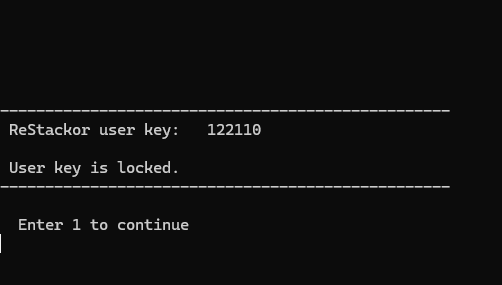
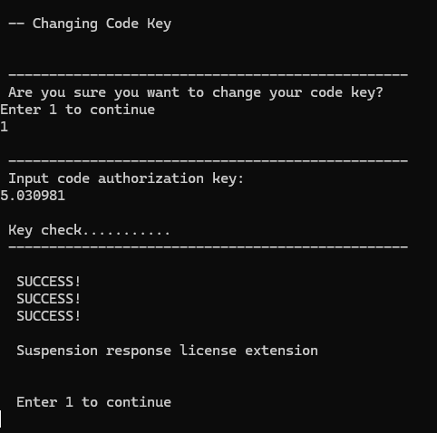
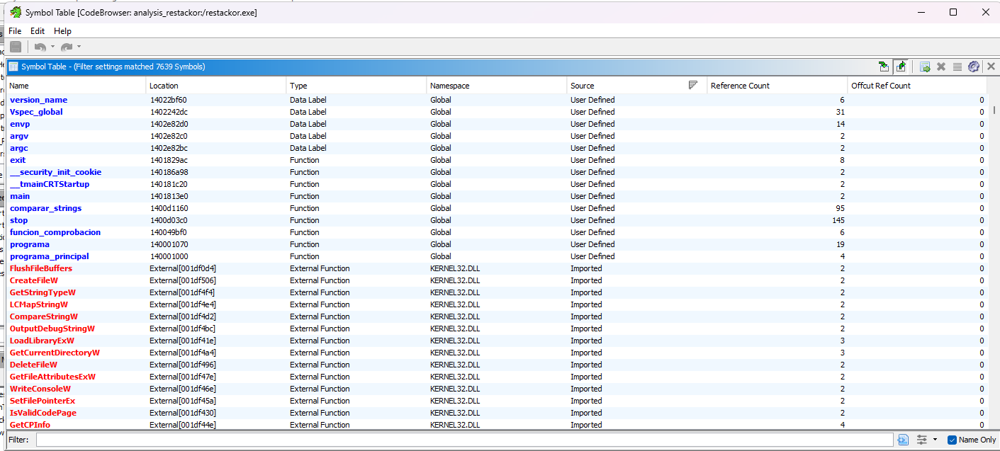

# RSPN KeyGen Restackor
RSPN level is PRO + response



```bash
python keygen.py
```

```
User key: XXXXXXX
Code authorization key (for level 4): 5.030981
  deviation: 0.xxxx  (must be < 1)
```

## Tools used

Ghidra (decomp), x64dbg (runtime inspection), HxD, python

## Info
- code key depends on user key so depends on the machine it runs.
- Para el nivel RSPN (4) user key must be <= ~429700. (funny)
- You can't edit mdfc.ali license file manually

# License system in Restackor

## 1. Intro

`restackor.exe` protects some functions behind 2FA:

- **User key**: number the program generates based on the machine's environment, shown in Ukey mode.
- **Code authorization key**: key introduced in Ckey mode that the executable asks for. It's validated against the user key, and the result returns a different license level.

This keygen targets level 4 (Pro + response), but building a universal one is not hard.

## 2. Data

After decompiling, the main function takes a parameter `codigo_vspec`:

| Code | Hex | Mode | Use |
|------|-----|------|-----|
| 21 | 0x15 | Ukey | Generates and shows the user key |
| 22 | 0x16 | Ckey | Asks for and passes the code key to `FUN_140070d90` |

At the end of the runtime there's a check:

```c
if (*result == 4 && *codigo_vspec < 4) *result = 2;
```

Ckey uses 0x16 (22 > 4), so we're fine.

## 3. Levels and objective constants

Each level is identified by a `double` constant stored in the binary:

| Level | Name | Target | Address |
|-------|------|--------|---------|
| 1 | demo | 23.0 | `0x1401e38c0` |
| 2 | pro | 25.0 | `0x1401e38c8` |
| 4 | pro + response / RSPN | **27.0** | `0x1401e38d8` |
| 5 | idk tbh | 20.0 | `0x1401e38e0` |

## 4. Validation algorithm

In `FUN_140070d90`, the input value is saved as `code_key` and the user key is normalized. Each level check is:

```
ukey_norm = user_key / 100000.0          # _DAT_14019fcc0 = 100000.0
q         = code_key / ukey_norm
valid  <=>  abs( sqrt(q² + ukey_norm²) · 2pi − target ) · 100000 < 1
```

Watch out:

1. **`2pi` is hardcoded as `6.28318`.** Using the full value of pi makes the tolerance fail.
2. **Normalization `_DAT_14019fcc0 = 100000.0`** when read as a double.
3. **Tolerance `1e-5`** (`*100000 < 1`). The code key must be almost exact.

The program converts to int as:

```c
local_48[0] = (int)(dVar10 + dVar14 * 1000000.0);  // dVar14 = code/ukey_norm
```

That's why the keygen iterates over `code·1e6`.

## 5. Keygen

Solving for `code_key` from the target:

```
sqrt(q² + ukey_norm²) · 2pi = target
q² = (target / 2pi)² − ukey_norm²
q  = sqrt( (target / 2pi)² − ukey_norm² )
code_key = q · ukey_norm
```

In Python:

```python
import math
TWO_PI = 6.28318
un = user_key / 100000.0
q = math.sqrt((target / TWO_PI)**2 - un**2)
code_key = q * un
```

Then sweep `±5` ints over `code_key·1e6` and pick the one that minimizes `|value − target|·1e5`, to land inside the tolerance of 1.

## 6. User key limit

Since `target/2pi ≈ 4.297` is constant, the `ukey_norm²` term can't exceed it, or `q²` would be negative (no solution):

```
ukey_norm² < (27 / 2pi)²
(user_key / 100000)² < 18.4658
user_key < 429718
```

Above ~429700 there's no code key for RSPN.

## 7. Why editing `mdfc.ali` does NOT work

- **Integers** feed the geometry (the level calculation).
- **Reference string** the user login, encoded with a `+0x5f` offset.

Three obstacles block it:

1. **Login validation comes first.** `comparar_strings` compares the current login (`XXXXX`) against the one stored in the string. If they don't match -> FATAL error, and the geometry is never even evaluated.
2. **Auto regeneration.** When validation fails, the program **rewrites the whole file** with default values, wiping any manual edit.
3. **Integrity checks.** After each calculation block, the code compares saved copies of the parameters against the freshly read ones (`movmskps`) and calls `stop()` if they differ.

